# 5주차 보고서

## Task 1
### 0단계

*구의 모든 픽셀이 같은 색이면 왜 원으로 보입니까?*

구 모양은 function makeSphere로 삼각형들을 이어서 동그랗게 보이게 만듦으로써 형성됩니다.

normals.push(x,y,z)로 빛을 받을때마다 밝아지게 설정하고 각자 색이 다른 정점들을  삼각형으로 연결지어 색이 변하게 만드는 것입니다. 하지만 모든 픽셀이 같은 색이면 색 차이와 입체감도 없기에 원으로 보입니다.

### 1) 단계 1~4 를 하나씩 적용한 캡처 4장 (같은 각도에서)
1단계
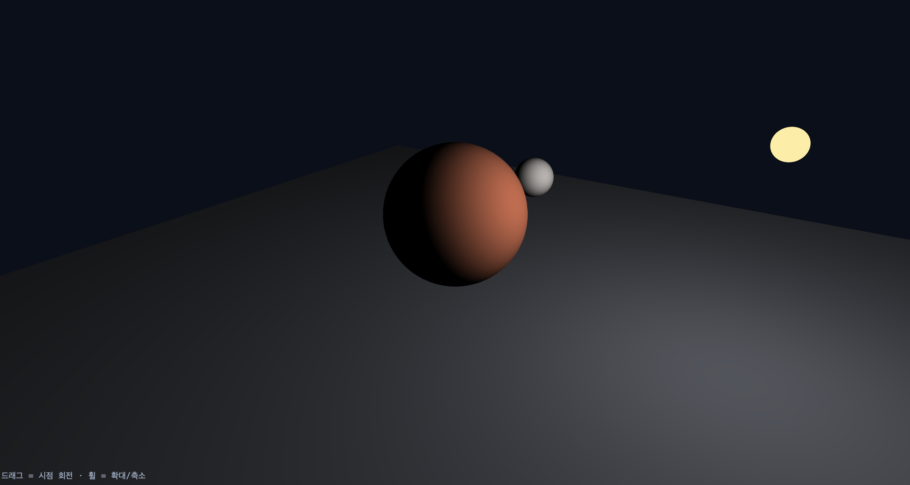

2단계
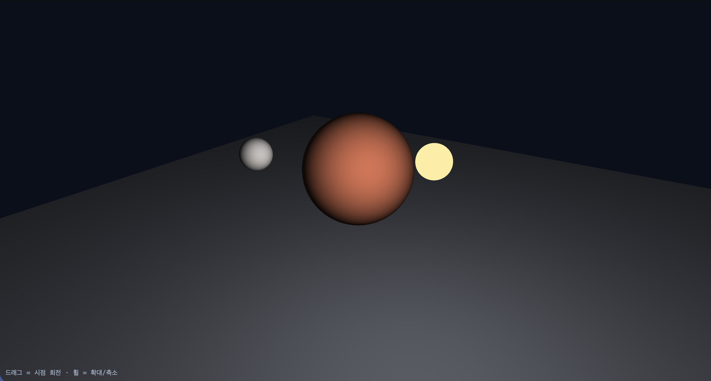

3단계
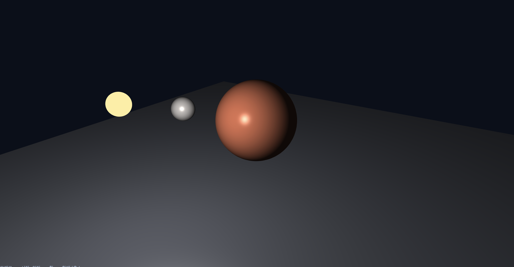

4단계
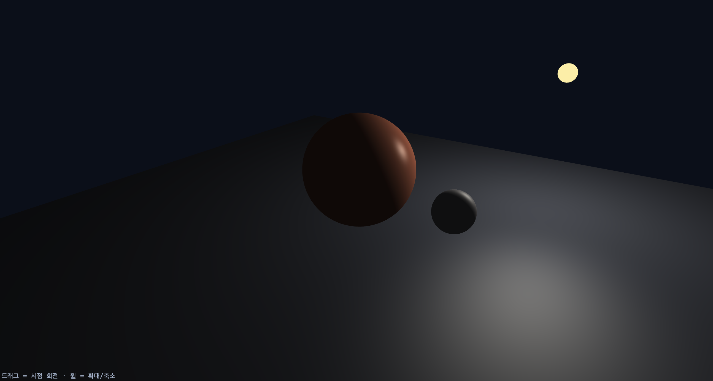

### 2) 단계 1 의 max 제거 예측과 실제 결과
밝기에 관한 코드이기에 제거할시 어두워질 것 같다. 태양만 빛나며 나머지 물체들은 전부 암전되었다. 빛으로 인한 반사가 일어나지 않았다. 

### 3) 단계 5 의 비교 캡처 2장 — mat3(uModel) 과 uNormalMat, 비균등 스케일 상태에서

비균등스케일에서  mat3(uModel) 지정시
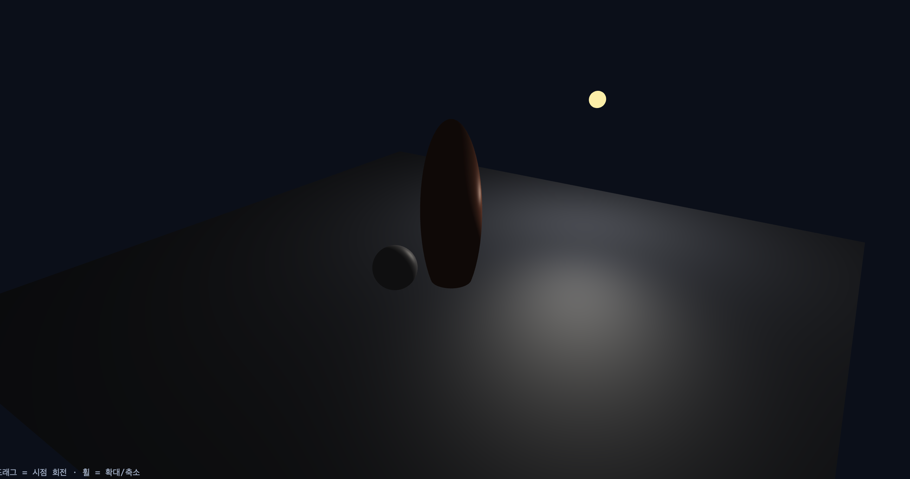

비균등스케일에서  uNormalMat 지정시
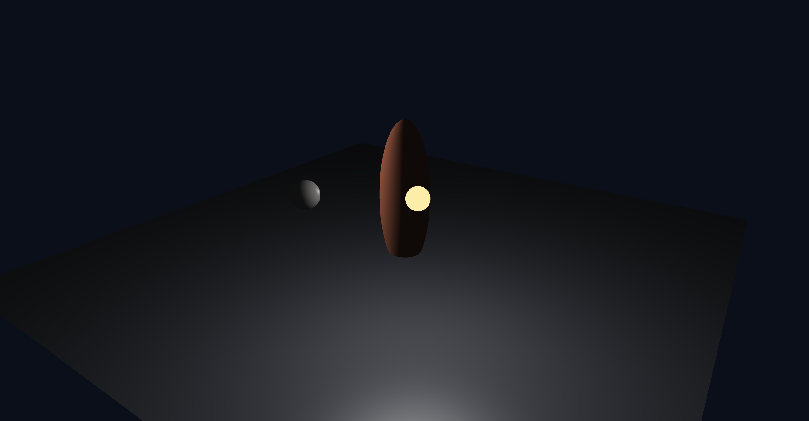

법선 벡터는 언제나 물체와 90도를 이루어야 합니다. 균등 스케일에서는 어떤 것을 쓰든 차이가 없지만 비균등 스케일일때는 다릅니다. 

길이를 늘이는 비균등 스케일에서는 법선 벡터도 같이 찌그러지기에 전자의 법선 벡터의 각도가 뒤틀립니다.

 행성의 모양이 달라지더라도 모델행렬의 역행렬을 구하고 전치시킨 후자를 사용하는 것이 좋습니다.

이 방법은 법선벡터의 기하학적 왜곡을 무시하고 변형된 표면과 법선을 수직으로 유지시키기 떄문입니다. 

### 4) 단계 6 에서 광원 종류를 바꾼 캡처와 무엇이 달라졌는지 한 문단
광원을 point로 설정한 경우
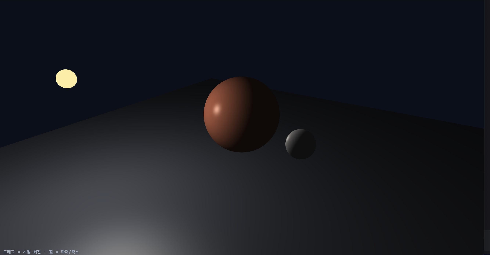

광원을 directional로 설정한 경우
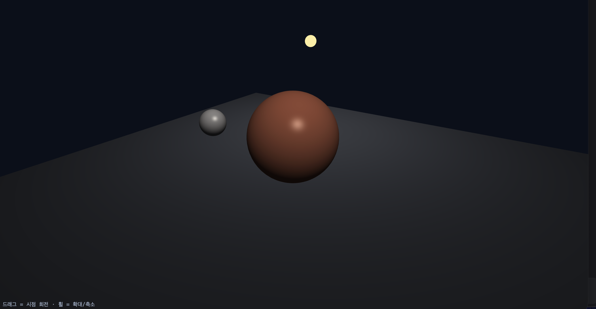

광원이 point인 경우 uLightPos(광원행성)에서 빛이 쏟아져나옵니다. 광원 행성의 움직임이 타행성들의 밝기에 변화를 줍니다. 하지만 directional은 먼 곳에서 일정히 쏟아지는 빛을 만들어냅니다. 그렇기에 광원 위치와 무관하게 장면 전체에 해당 빛이 영향을 줍니다. 전체적인 무대의 밝기도 밝아졌습니다. directional은 거리에 따라 빛이 감소하지 않아 일정한 느낌을 주지만 point은 광원이 물체에게서 멀어지면 빛이 약해집니다. 

### 4-1) spot 구현하기

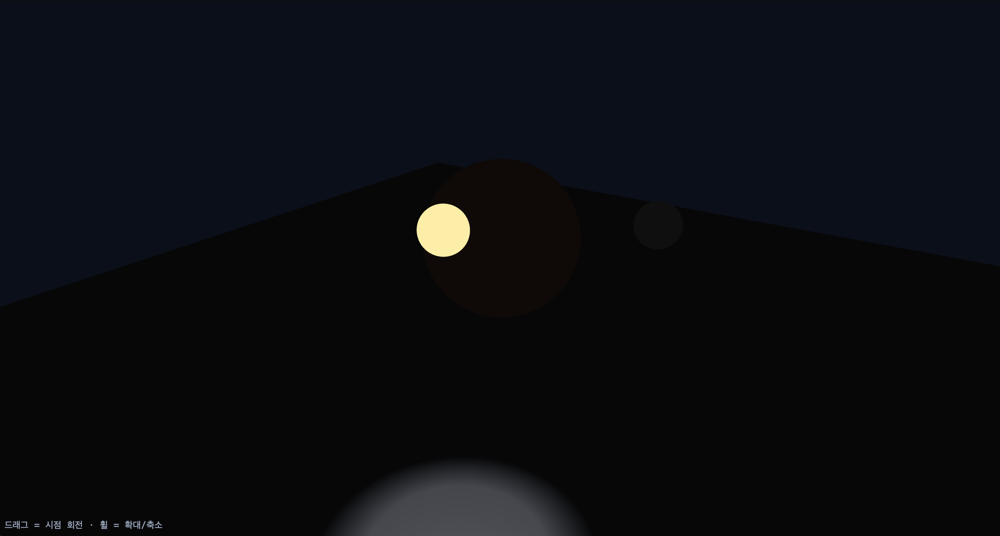

directional과 point을 주석처리하고 spot을 구현하면 주변부가 모두 어두워지며 바로 아래의 스포트라이트 형식의 빛이 만들어집니다. 

## task 2

가장 큰 행성의 이름은 1성, 붉은 행성은 2성, 노란 항성은 3성, 분홍 행성은 핑성으로 이름지었습니다.

1. 의도 — 어떤 장면·분위기를 만들려 했는지 두세 문장

고급진 아크릴로 만든듯한 태양계 모형 분위기를 주고싶었습니다.
point빛을 발산하는 중앙의 얼음 행성인 1성과 그 주위를 공전하는 붉은 암석행성(2성), 얼음행성을 향하는 노란 spot 3성의 움직임을 관찰하는 것이 주요 목표입니다. 
3성보다 더 뒤에서 위치가 고정된 핑성은 spot이 닿지 않는 곳에 있는 물체는 어떻게 관찰될까가 궁금해서 놓아보았습니다.

2. 방법 — 광원을 몇 개, 어떤 종류로, 어디에, 무슨 색으로 놓았는지. 재질은 어떻게 나눴는지

- 광원은 1성의 푸른 빛과 노란색 3성으로 총 두 개입니다.

- 1성에게는 point light을 활용해 한색의 빛이 나오는 광원으로 설정했습니다. 빛은 행성의 정중앙이 아닌 대각선 외부로 뻈습니다. 3성은 spotlight의 각도를 조정해 노란색 광원이 되도록 만들었습니다.

- 1성은 화면의 정중앙에 위치했고, 3성은 1성의 궤도를 돌고있습니다.

- uKs는 하이라이트를 얼마나 반사하는지 정해주며 uShininess는 하이라이트 맺히는 집중도의 넓이값입니다.

이를 이용해 2성의 재질을 매트한 붉은 암석행성처럼 보이게 rgb값과 uShiniess값을 변경했습니다. 1성은  uShininess를 높이고 uK도 0.9정도로 설정해 얼음행성으로 보이게 했습니다.

3. 광원을 하나씩 끈 캡처 (각 광원이 무엇을 담당하는지 보이게)

1번빛: point광원 활용
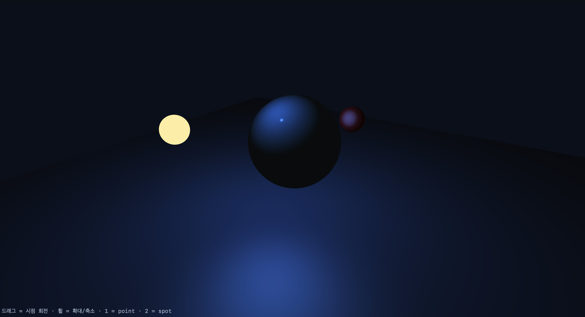

2번빛: spot을 활용
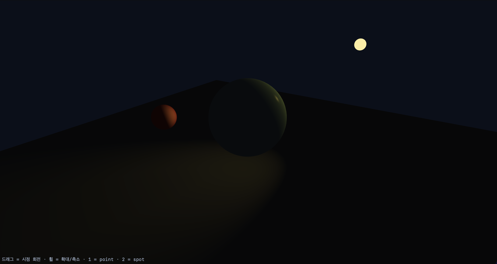

4. 최종 캡처 1장 이상

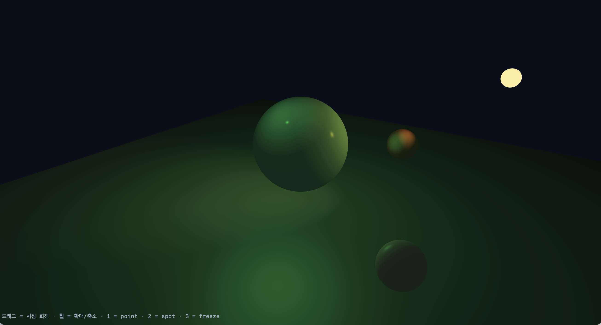

5. AI 를 썼다면 무엇을 요청했고 무엇을 고쳤는지

- AI에게 pointPos를 한색으로 변경하고 가장 큰 중앙행성에게서 방출되게끔 만들라고 요청했습니다. AI는 행성 정중앙 코어 내부에서 빛이 나오게 했지만 빛이 깨진듯이 보이고 균등하지 않게 결과가 출력됐습니다. 이에 따라 스스로 위치를 조금씩 바꿔보았고 결국 광원을 중앙이 아닌 대각선 위로 조금 빼며 안정적인 위치를 찾았습니다.

- task1을 복사 붙여넣기해 task2를 수행하는 과정에서 uNormalMat의 연산이 꼬여 한색 빛의 위지가 2성의 특정 면에 고정된 듯이 보였습니다. 이에 따라 1성을 바라보지 않는 면에서 푸른 빛이 검출되며 논리적으로 모델이 맞지 않았습니다. 이에 대한 원인을 AI에게 분석해달라고 요청했습니다. 그 결과 normalFromMat4 함수 속 행렬이 전치돼있어 2성의 법선이 꼬인 것이 원인이었습니다. 이 꼬인 행렬을 uNormalMat함수가 계산했기에 최종적으로 전치된 행렬값이 적용되어 컴퓨터가 2성의 앞면을 뒷면이라 착각해 반대로 빛을 받게 했다는 답을 얻었습니다. 그리하여 5단계에 uNormalMat * aNormal 계산법을 사용하지 않고 기존의 mat3(uModel) * aNormal 식을 사용해 전치된 행렬 문제를 수정해 정상작동시켰습니다.

- 1성의 uKs를 0.9정도로 높게, uShininess를 매우 높게하여 표면이 반짝이게끔 보이게 수정한 후 행성의 색깔을 탁한 하늘색으로 바꿔달라고 요청했고 1성의 재질을 얇고 매끄러운 얼음처럼 변경했습니다. 
하지만 과하게 표면부가 매끄럽다 판단하여 uShininess값을 AI가 초기설정한 256에서 230으로 고쳤습니다.

- 빛이 원활하게 작동되는지 궁금해서 3이라는 키를 누르면 모든 행성과 빛의 움직임이 멈추는 AI를 통해 freeze기능을 추가했습니다.

- uShiniess값과 색상을 제외한 2성의 설정값 참고하여 움직이지 않는 4성을 만들어달라고 이야기했습니다. 다만 Copilot은 spot 360도로 닿는 곳에 행성을 위치시켴 제가 직접 값을 조정하며 만족스러운 곳에 자리잡게했습니다.

-uTime 값을 이용해 1성의 빛이 시간에 따라 변하게 만들었습니다. 이랬더니 point 빛의 밝기가 너무 밝아 값을 줄였습니다.
