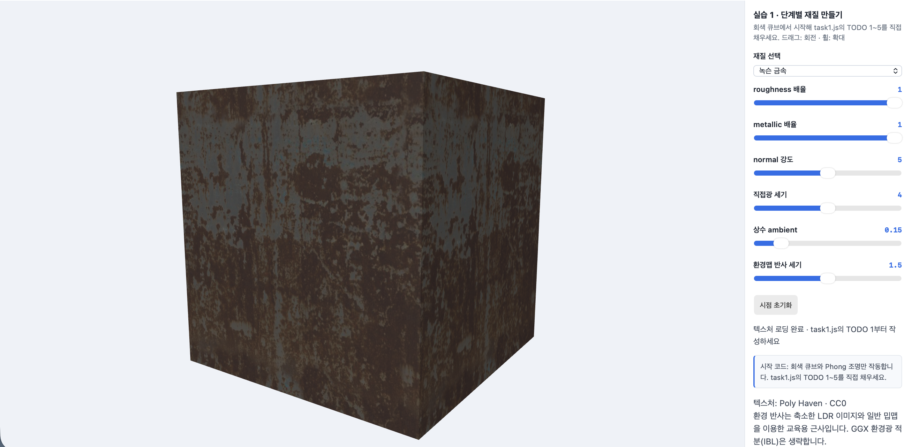

# 6주차 보고서

# task 1

**Step 1**


**Step2**


**Step3**



**Step4**

사이트에 올라온 코드만으로는 normal의 변화를 감지하기 힘들어 코드를 다음과 같이 바꿨습니다. 1e-8라는 값을 줄여 접선의 방향의 축소를 줄여 normal 변화를 증폭시켰습니다.
```
float inv=inversesqrt(max(max(dot(T,T),dot(B,B)),1e-20));
```

Normal 강도 0


Normal 강도 5


Normal 강도 10


**Step 5**
환경맵 반사 세기 1


환경맵 반사 세기 2


**직접광, ambient, 환경맵 끄기**

