# 6주차 보고서

# task 1

**Step 1**
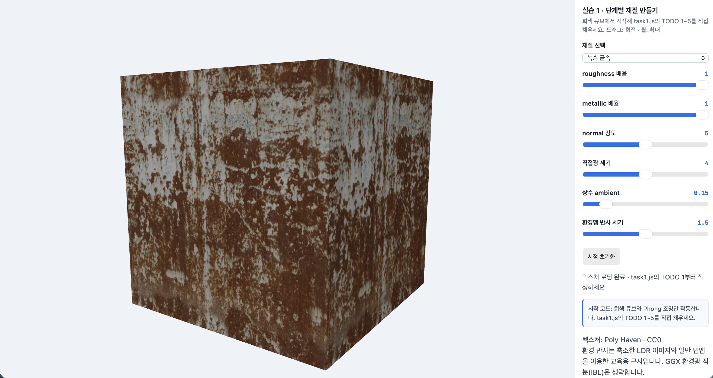

**Step2**
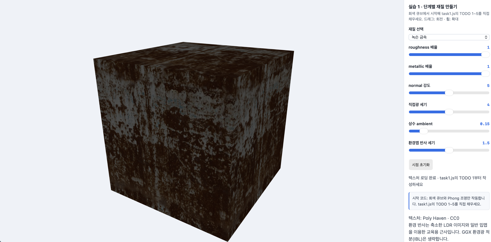

**Step3**


**Step4**

사이트에 올라온 코드만으로는 normal의 변화를 감지하기 힘들어 코드를 다음과 같이 바꿨습니다. 

```js
float inv=inversesqrt(max(max(dot(T,T),dot(B,B)),1e-20));
```
1e-8라는 값을 줄여 접선의 방향의 축소를 줄여 normal 변화를 증폭시켰습니다.

Normal 강도 0
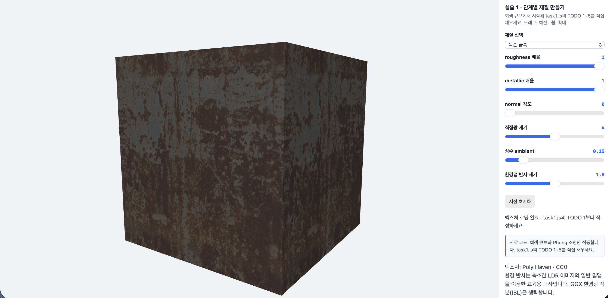

Normal 강도 5
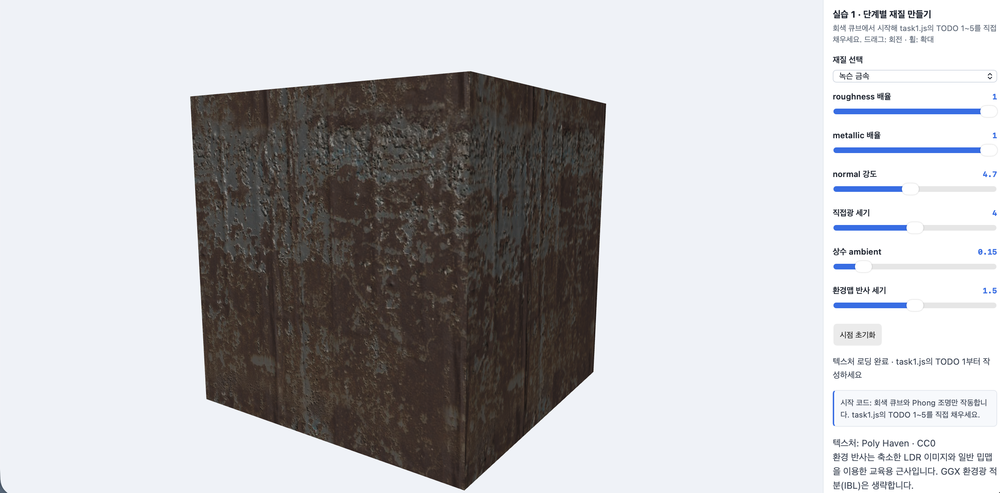

Normal 강도 10
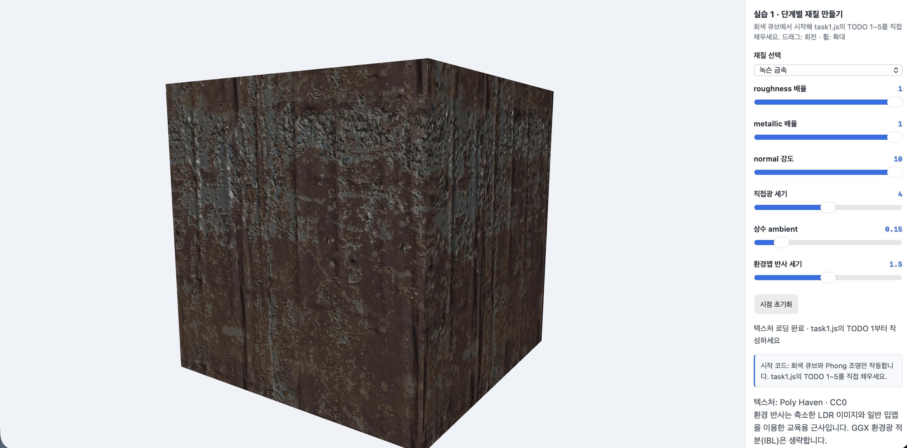


**Step 5**
환경맵 반사 세기 1
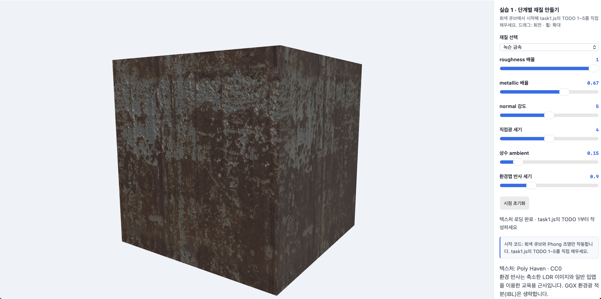

환경맵 반사 세기 2


**직접광, ambient, 환경맵 끄기**
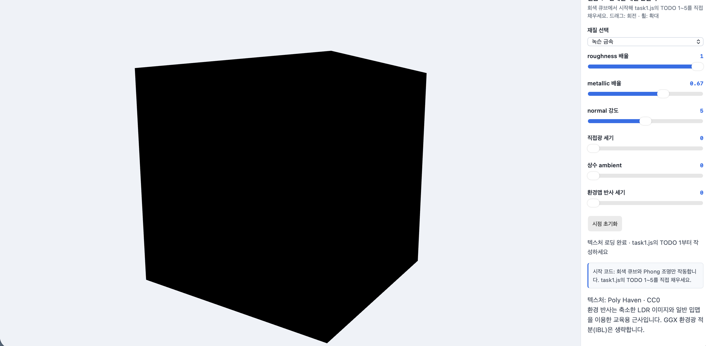


## task 2

유명 빙수 프렌차이즈의 두바이 초코 빙수를 모티브로 한 행성입니다.
태양이 중앙 “빙수 행성”에 다가가면 초코 코팅이 녹습니다. 흰 “아이스크림 행성”이 다가가면 분화구에서 카다이프 용암이 분출됩니다.


### 행성에 적용할 서로 다른 원인 두 개
1) 초코의 녹는 정도: 광원과 가까워짐에따라 중앙 행성(빙수행성)의 초코 코팅이 줄어들고 바닥이 보입니다.
이때 변화시키는 건 태양의 거리입니다.

2) 골다공증 조석가열
중앙행성(빙수행성)과 공전행성(아이스크림행성)이 가까워질수록 조석가열로 인해 중앙행성에 화산이 터집니다.
이때 변화시키는건 공전행성의 거리입니다.


PBR재질
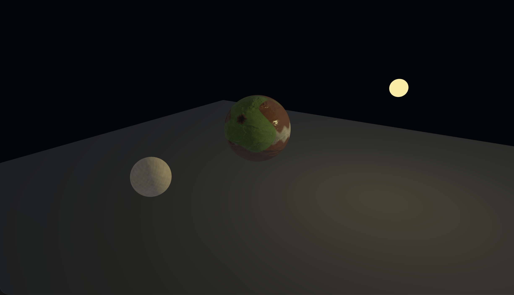


초코 마스크
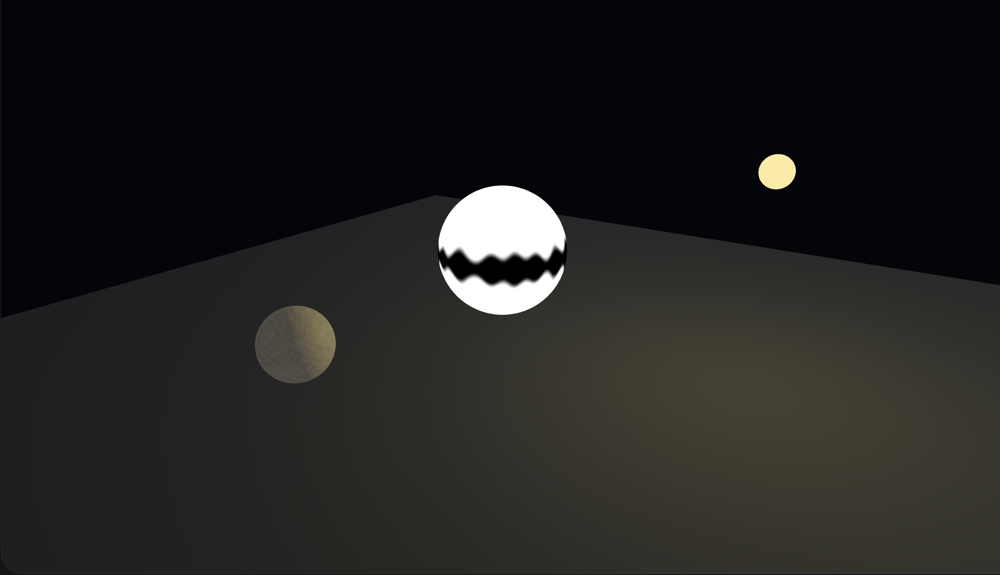

카다이프 마스크
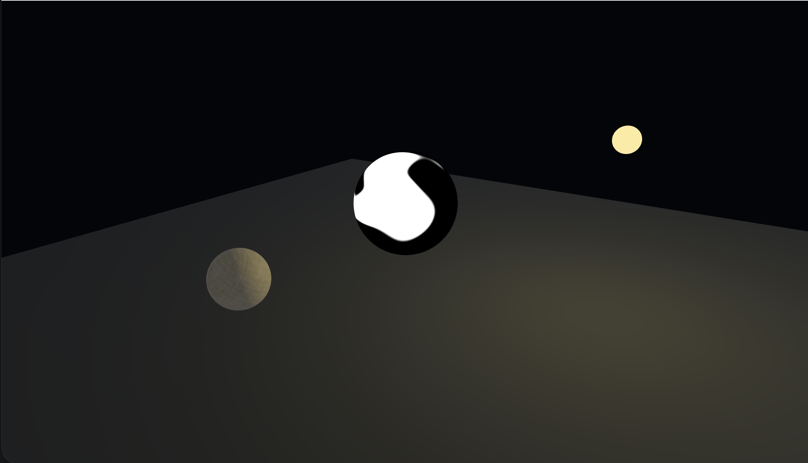


### 대면평가 질문

##Task1. 
- **같은 메시인데 나무와 금속이 달라 보이는 정보를 어디에 저장했나요?**

asset에 저장되어있습니다. 


- **roughness와 normal map은 각각 무엇을 바꾸나요? 실루엣은 왜 같나요?**

roughness은 반사의 퍼짐을, normal map은 접선 공간의 법선을 저장합니다. 두 요소는 조명과 관련해 영향을 주지만 메시의 위치 자체가 변한 것은 아니기에 실루엣이 같습니다.


- **녹과 깨끗한 금속의 metallic 값이 달라야 하는 이유는 무엇인가요?**

metalic은 거칠기를 결정하는 요소입니다. 금속성을 추가해 반사 특성을 만듭니다. 
깨끗한 금속은 metalic을 1로, 녹이 발생한 부분을 0에 가깝게 설정하여 반사 특성이 느껴지게 합니다. 


- **D·F·G 중 하이라이트의 퍼짐·반사 비율·미세면 가림은 각각 어디에 해당하나요?**

다음에 해당합니다. 
```js
float D = a2 / max(PI*den*den, 1e-6); //D: 미세면 법선 분포
 float k = (rough+1.0)*(rough+1.0)/8.0;
 float G = (nl/(nl*(1.0-k)+k)) * (nv/(nv*(1.0-k)+k)); //G: 미세면 가림
 vec3 F0 = mix(vec3(0.04), base, metal);
 vec3 F = F0 + (1.0-F0)*pow(1.0-vh,5.0); //F: Fresnel 반사율
```


- **어떤 맵은 sRGB로 읽고 어떤 맵은 그대로 읽나요? 두 번 선형화하면 어떻게 되나요?**
색상 정보를 저장하는 환경맵 등은 sRGB로 읽습니다. AO맵은 색이 아닌 수치데이터를 읽어 sRGB를 변화 하지 않습니다. task1에서는 normal·roughness·metallic·AO는 수치데이터가 선형화되지않고 그대로 읽힙니다.


- **확대와 축소의 문제는 어떻게 다른가요? 비스듬한 바닥에 비등방성 필터가 필요한 이유는 무엇인가요?**

확대를 할 때는 화면이 도드랄지거나 흐릿해집니다. 축소할때는 멀리있는 표면의 흐릿함을 줄이고 선명도를 유지할 수 있습니다. 
비스듬한 바닥은 각도에 따라서 부분부분의 텍스쳐의 확대와 축소가 균일하지 않습니다. 그렇기에 Anisotropic를 이용해 비스듬한 바닥의 선명도를 개선해야 합니다. 


- **광원을 껐는데 물체가 보인다면 어떤 경로의 빛이 남아 있나요?**

광원(직접광)을 꺼도 물체가 보입니다. 상수 ambient를 0으로 줄이지 않는 이상 물체의 재질이 보입니다. 이는 주변광과 환경맵 반사가 남아있기 때문입니다. 


## task2

- **실습 2의 첫 조건은 태양계 장면의 어떤 변수와 연결되며, 행성 표면의 어느 위치를 바꾸나요?**

태양과 아이스크림 행성 사이의 거리(uStarDistance)와 연결됩니다. 
태양과의 거리에 따라 중앙 행성의 초콜릿 코팅 범위가 변화합니다. 행성의 로컬 좌표 vLocal.y를 이용해 위도를 계산하며 북극과 남극에서 시작해 적도 방향으로 초콜릿 영역이 전개됩니다.  chocolateMask를 이용해 표면의 Base Color와 Roughness를 함께 변경해 질퍽한 초콜릿의 재질이 느껴지게 만들었습니다. 


- **둘째 조건만 바꿨을 때 다른 마스크가 독립적으로 변하는 화면과 계산 코드를 보여 줄 수 있나요?**
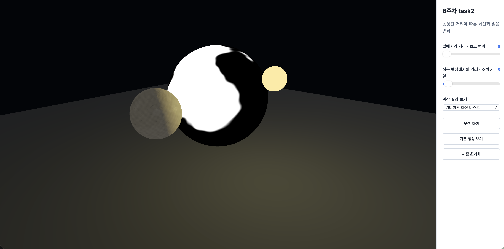
아이스크림이 가까워질수록 eruption이 계산됩니다. 이를 이용해 카다이프 화산의 분출 범위인 uFlowReach를 변화시켰습니다. 프래그먼트 셰이더에서는 분화구 중심으로부터의 거리(r)와 방향(angle), 분출 범위와 시간을 이용해 flowMask를 계산했습니다. 이후 이것을 Base Color와 Roughness에 적용해 화산 분출을 구현했습니다. 


```js
//—————아이스크림 행성의 거리에 따른 화산 분출 값 설정—————
const eruption=1.0-Number(moonOrbit.value)/100;
const targetReach=1.65*eruption;
const delta=Math.max(0,Math.min(dt,0.05));

flowReach+=(targetReach-flowReach)
           *Math.min(1,delta*(0.8+eruption*1.6));

gl.uniform1f(U.uStarDistance,starAmount);
gl.uniform1f(U.uEruption,eruption);
gl.uniform1f(U.uTime,time);
gl.uniform1f(U.uFlowReach,flowReach);


//—————화산 마스크 계산—————
if(uIsIcePlanet){

  vec3 pos=normalize(vLocal);
  vec3 center=normalize(vec3(0.0,0.5,0.866));

  vec3 right=normalize(cross(vec3(0,1,0),center));
  vec3 up=normalize(cross(center,right));

  // 분화구에서 얼마나 떨어졌는지
  float r=acos(clamp(dot(pos,center),-1.0,1.0));
  float angle=atan(dot(pos,up),dot(pos,right));

  // 각도에 따라 가장자리를 불규칙하게 만들어 둥근 화구에 뾰족한 암석을 더한다.
  float craterRadius=0.095
      +0.012*sin(angle*5.0+0.4)
      +0.009*sin(angle*9.0-0.8)
      +0.018*pow(abs(sin(angle*6.0+0.3)),3.0);
  float craterInterior=1.0-smoothstep(craterRadius-0.008,craterRadius+0.006,r);
  float craterOuter=1.0-smoothstep(craterRadius+0.035,craterRadius+0.055,r);
  float craterRim=craterOuter*(1.0-craterInterior);

  // 2. 굵고 구불구불한 분출 영역
  // 방향에 따라 흐름이 불규칙하게 휘어지도록 계산
  float curve=
      0.23*sin(angle*3.0+r*3.5)
     +0.14*sin(angle*2.0-r*5.0+1.3)
     +0.08*sin(angle*5.0+r*2.0);

  // 작은 표면 굴곡
  float noise=
      sin(pos.x*17.0+pos.z*11.0)
     *sin(pos.y*21.0-pos.x*13.0)*0.045;

  // 3. 분화구에서 바깥으로 차오르는 경계
  float speed=2.0+uEruption*8.0;

  // 새 분출물이 바깥으로 밀려나는 울컥거림
  float pulse=0.04*uEruption*
      sin(r*16.0-uTime*speed);

  float front=max(0.0,
      uFlowReach*(0.75+curve)
      +noise*uEruption
      +pulse
  );

  // 경계 안쪽을 전부 초록색으로 채움
  float flowMask=1.0-smoothstep(
      front-0.07,
      front+0.04,
      r
  );

  // 4. 퍼진 영역 사이에 원래 표면이 조금 남도록
  float patches=
      sin(pos.x*11.0+pos.y*6.0)
     *sin(pos.z*13.0-pos.y*8.0);

  float gaps=smoothstep(-0.8,-0.25,patches);

  // 분화구 근처는 연결, 바깥쪽은 불규칙하게
  float outer=smoothstep(0.18,0.55,r);

  // flowMask*=mix(1.0,0.35+0.65*gaps,outer*0.65); // 카다이프 영역 바깥쪽의 불규칙한 얼룩 만듦

  //  작은 행성이 가까워질수록 uEruption 값이 커지고 이 값을 flowmask에 곱하기에 카다이프 색이 변함 

  //flowMask=flowMask*uEruption; //이거는 카다이프 투명도 조절
  
  flowMask *= step(0.001, uFlowReach);

  // 5. 피스타치오 초록색
  vec3 green=srgbToLinear(vec3(0.32,0.52,0.17));
  vec3 gold=srgbToLinear(vec3(0.92,0.72,0.32));

  // 6. 작은 카다이프 조각 (짧은 세로선)
  vec2 p=vec2(dot(pos,right),dot(pos,up))*55.0;
  vec2 cell=floor(p);
  vec2 f=fract(p);

  float random=fract(sin(
      dot(cell,vec2(127.1,311.7))
  )*43758.5453);

  // 드문드문 황금색 조각 배치
  float particle=
      step(0.93,random)
     *(1.0-smoothstep(0.06,0.11,abs(f.x-0.5)))
     *(1.0-smoothstep(0.23,0.32,abs(f.y-0.5)));

  vec3 kataifiColor=mix(green,gold,particle);

  // 7. 흑백 마스크 진단
  if(uKataifiMaskView){
    outColor=vec4(vec3(uSurfaceChanges?flowMask:0.0),1.0);
    return;
  }

 if(uSurfaceChanges){
  // 8. 카다이프 PBR 재질 적용

   // flowMask가 0이면 기존 표면색
   // flowMask가 1이면 피스타치오 색상
    // 0과 1 사이면 두 색상을 혼합
    // 따라서 uEruption이 커지면 초록색이 더 강하게 나타남
  base=mix(base,kataifiColor,flowMask);
  rough=mix(rough,0.85,flowMask);
  

  // 기존 암석 텍스처의 명암을 갈색 화구 테두리에도 유지한다.
  vec3 rockColor=srgbToLinear(texture(uColor,vUV).rgb);
  float rockDetail=dot(rockColor,vec3(.2126,.7152,.0722));
  vec3 rimColor=vec3(0.20,0.075,0.032)*(0.65+0.7*rockDetail);
  float innerDepth=1.0-smoothstep(0.0,craterRadius,r);
  vec3 innerColor=mix(vec3(0.035,0.012,0.005),vec3(0.008,0.003,0.002),innerDepth);
  base=mix(base,rimColor,craterRim);
  base=mix(base,innerColor,craterInterior);
  rough=mix(rough,0.9,craterOuter);
  }
 }


// —————마스크 PBR 재질 적용—————
```


- **두 마스크가 겹치면 어떤 재질이 우선하나요? 완성 텍스처 파일 교체와는 구현이 어떻게 다른가요?**

프래그먼트 셰이더에서 먼저 적용된 재질이 나중에 적용되는 물질을 덮어쓰는 구조입니다. 그렇기에 초콜릿보다 **카다이프 재질이 우선시**됩니다. 
기존의 방식은 완성된 텍스쳐를 교체했습니다. 하지만 task2는 기존 PBR 텍스처를 바탕으로 행성의 조표와 태양의 공전, 아이스크림 행성의 거리 등을 계산해 두 마스크를 실시간으로 적용합니다. 그렇기에 특정 표면의 재질이 연속적으로 변화합니다. 


- **AI가 만든 코드에서 본인이 확인하거나 바로잡은 부분을 한 곳 보여 줄 수 있나요?**
아이스크림 행성이 두바이행성에 가까워질수록 카다이프 화산의 분출정도가 늘어나게끔 AI에게 코드를 짜달라고 했습니다. 그 결과 제가 원하지 않았던 위치변화별 불투명도 조정 기능이 추가되었습니다. 또한 카다이프 사이의 원래 행성의 표면이 남겨지게 되어 불필요한 얼룩들이 카다이프 내에 발생했습니다. 
이에 따라 주석을 통해 코드를 분석하고 불필요한 부분에 주석처리를 해 고쳤습니다. 다음은 얼룩 수정 코드입니다. 


```js
  // flowMask*=mix(1.0,0.35+0.65*gaps,outer*0.65); // 카다이프 영역 바깥쪽의 불규칙한 얼룩 만듦

  //  작은 행성이 가까워질수록 uEruption 값이 커지고 이 값을 flowmask에 곱하기에 카다이프 색이 변함 

  //flowMask=flowMask*uEruption; //이거는 카다이프 투명도 조절
  
  flowMask *= step(0.001, uFlowReach);
```

- **발광 표시가 주변 물체를 자동으로 비추나요? Bloom을 추가한다면 어떤 중간 이미지가 필요한가요?**
발광 표시는 uEmissive를 적용해 태양 자체를 빛내지만 주변 물체도 자동으로 비추지는 않습니다. Bloom을 추가하기위해선 장면을 렌더 텍스처에 저장하고 밝은 부분을 추출한 중간 이미지가 필요합니다. 이들을 블러처리해 원본과 합성하면 빛번짐 효과를 만들 수 있습니다. 

