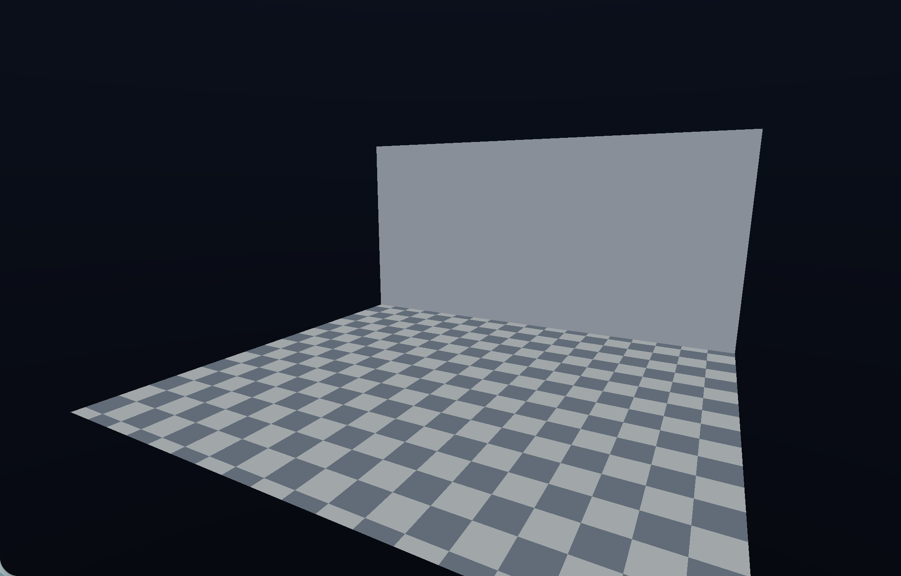
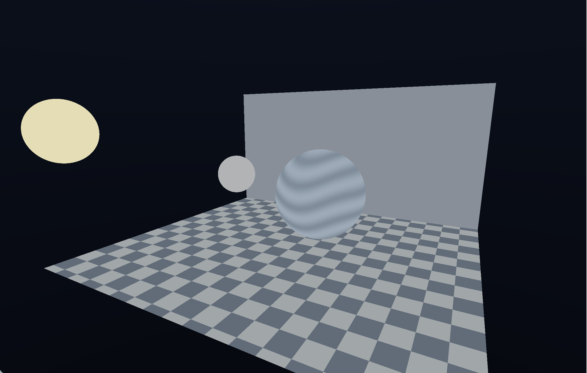
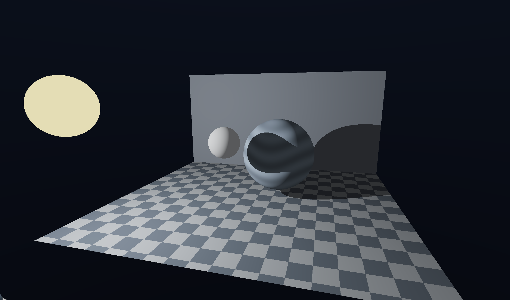
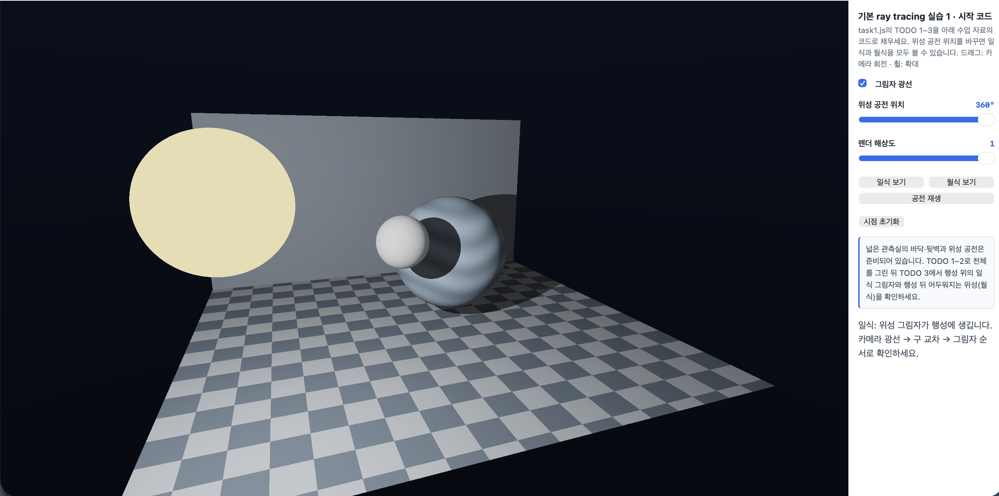
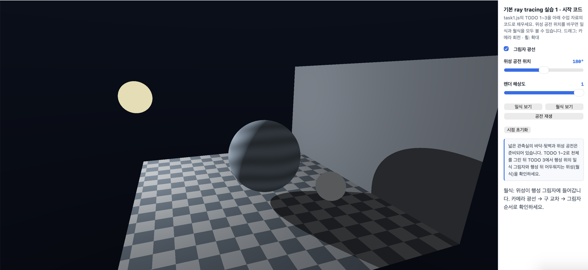
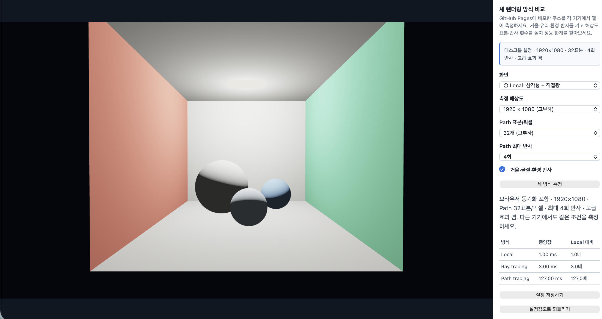

# 7주차 보고서


## task 1

Step1 - 카메라 광선 만들기



Step2 - 광선과 구 교차거리 찾기



Step3 - 직접광과 식의 그림자



### 대면 질의응답 


- **1의 일식·월식 캡처 공전**
일식


월식



- **위치·그림자 광선의 역할**

task1은 화면의 각 픽셀에서 가상의 카메라 광선을 쏘아 3D 공간 내의 물체(구, 바닥, 벽)와 부딪히는 지점을 찾고 해당 지점에서 그림자같은 빛의 물리적 특성을 계산해 색상을 결정하는 구조로 작동합니다. 

*위치*

슬라이더로 움직이는 위성의 위치를 매 프레임 계산해서 updateMoon 함수에 넣습니다.  
슬라이더로 공전 각도를 조절하면 updateMoon 함수가 그 각도를 받아 위성의 위치를 계산합니다. 행성의 중심을 기준으로 별을 향하는 방향(starward)과 그에 수직인 방향(sideways)에 각각 코사인과 사인 값을 곱하여 더하고 공전 반지름인 1.50을 값을 산출해 행성과 위성이 일정 거리를 유지하며 궤도를 그리며 움직입니다. 
0°에서는 별—위성—행성이 되어 위성이 빛을 가리는 물체고 180°에서는 별—행성—위성이 되어 위성이 빛을 받지 못하는 물체가 됩니다. 


*광선*

그림자광선은 특정 표면이 광원과 직선상에 연결돼있는지를 판별해 그림자 생성 여부를 판별합니다. blocker T를 통해 표면의 한 점에서 물체(blockerId)를 향해 쏘아지며 그 광선이 표면에 도달하는지 검사하는 방식으로 진행됩니다. 만약 물체가 항성(0)이 아닌 물체가 있으며 부딪힌 거리가 광원까지의 거리(lightDistance)보다 가깝다면 **빛과 표면 사이에 장애물이 존재**한다고 인지합니다. 이때 표면에 도달하는 빛(visible)은 0이 됩니다. 

하지만 이대로 두면 그림자의 색은 칠흑이 되어버려 어색합니다. 그렇기에 주변광의 색을 ambient의 값을 조정하여 그림자부분에 최소한의 빛을 남겨줘 자연스럽게 만듭니다.

## task 2

### 1. 배포와 기기 : PC+휴대폰
사양
| 기기 종류 | GPU | CPU(확인 가능한 범위) | 운영체제 | 브라우저 | 전원 상태
| - | - | - | - | - | - |
| MacBook Pro 14 | Apple M2 Pro 19-Core GPU | Apple M2 Pro | macOS Tahoe (버전 26.6.2) | 사파리 | 59% (배터리 사용중) |
| iPhone 15 Pro | GPU명 확인불가, GPU Benchmark Score: 24346 | Apple A17 @ 3.78 GHz | iOS 26.2.2 | 사파리 | 29% (배터리 사용중) |

### 2.공통 조건 비교 -  640×360·8표본·2회 반사·고급 효과 켬

*MacBook Pro 14 측정 결과*

| 방식 | 1회차 중앙값 | 1회차 Local 대비 | 2회차 중앙값 | 2회차 Local 대비 | 3회차 중앙값 | 3회차 Local 대비 | 
| - | - | - | - | - | - | - | 
| Local | 1.00 ms | 1.0배 | 1.00 ms | 1.0배 | 1.00 ms | 1.0배 | 
| Ray tracing | 1.00 ms | 1.0배 | 1.00 ms | 1.0배 | 1.00 ms | 1.0배 | 
| Path tracing | 8.00 ms | 8.0배 | 6.00 ms | 6.0배 | 5.00 ms | 5.0배 | 


*iPhone 15 Pro 측정 결과*
| 방식 | 1회차 중앙값 | 1회차 Local 대비 | 2회차 중앙값 | 2회차 Local 대비 | 3회차 중앙값 | 3회차 Local 대비 | 
| - | - | - | - | - | - | - | 
| Local | 1.00 ms | 1.0배 | 1.00 ms | 1.0배 | 2.00 ms | 2.0배 | 
| Ray tracing | 2.00 ms | 2.0배 | 2.00 ms | 2.0배 | 2.00 ms | 1.0배 | 
| Path tracing | 7.00 ms | 7.0배 | 8.00 ms | 8.0배 | 7.00 ms | 3.5배 | 


### 3. 부하 올리기 (중앙값 비교)


**컴퓨터**

*해상도 변동 · Path 8표본/픽셀 · 최대 2회 반사*
| 방식 | 960(고급효과 O) | 960(고급효과 X) | 1280(고급효과 O) | 1280(고급효과X) | 1920(고급효과O) | 1920(고급효과X) |
| - | - | - | - | - | - | - |
| Local | 1.00ms | 1.00ms | 1.00ms | 1.00ms | 1.00ms | 1.00ms |
| Ray tracing | 1.00ms | 2.00ms | 2.00ms | 2.00ms | 3.00ms | 3.00ms |
| Path tracing | 7.00ms | 1.00ms | 9.00ms | 9.00ms | 19.00ms | 19.00ms |


*640×360 · Path 변동 · 최대 2회 반사*
| 방식 | 16개(고급효과O) | 16개(고급효과X) | 32개(고급효과O) | 32개(고급효과X) | 
| - | - | - | - | - | 
| Local | 1.00ms | 1.00ms | 1.00ms | 1.00ms |
| Ray tracing | 1.00ms | 1.00ms | 1.00ms | 1.00ms |
| Path tracing | 6.00ms | 8.00ms | 10.00ms | 10.00ms |


*640×360 · Path 8표본/픽셀 · 반사 변동*
| 방식  | 3회(고급효과O) | 3회(고급효과X) | 4회(고급효과O) | 4회(고급효과X) |
| - | - | - | - | - | 
| Local | 1.00ms | 1.00ms | 1.00ms | 1.00ms |
| Ray tracing | 1.00ms | 1.00ms | 1.00ms | 1.00ms |
| Path tracing | 6.00ms | 6.00ms | 7.00ms | 7.00ms |


**휴대폰**

*해상도 변동 · Path 8표본/픽셀 · 최대 2회 반사*
| 방식 | 960(고급효과 O) | 960(고급효과 X) | 1280(고급효과 O) | 1280(고급효과X) | 1920(고급효과O) | 1920(고급효과X) |
| - | - | - | - | - | - | - |
| Local | 2.00ms | 2.00ms | 2.00ms | 2.00ms | 2.00ms | 2.00ms |
| Ray tracing | 3.00ms | 3.00ms | 4.00ms | 4.00ms | 4.00ms | 3.00ms |
| Path tracing | 11.00ms | 11.00ms | 18.00ms | 17.00ms | 37.00ms | 37.00ms |


*640×360 · Path 변동 · 최대 2회 반사*

| 방식 | 16개(고급효과O) | 16개(고급효과X) | 32개(고급효과O) | 32개(고급효과X) | 
| - | - | - | - | - | 
| Local | 1.00ms | 1.00ms | 1.00ms | 1.00ms |
| Ray tracing | 2.00ms | 2.00ms | 2.00ms | 2.00ms |
| Path tracing | 10.00ms | 10.00ms | 19.00ms | 18.00ms |


*640×360 · Path 8표본/픽셀 · 반사 변동*
| 방식  | 3회(고급효과O) | 3회(고급효과X) | 4회(고급효과O) | 4회(고급효과X) |
| - | - | - | - | - | 
| Local | 1.00ms | 1.00ms | 1.00ms | 1.00ms |
| Ray tracing | 2.00ms | 2.00ms | 2.00ms | 2.00ms |
| Path tracing | 8.00ms | 8.00ms | 9.00ms | 9.00ms |


### 4. 기기별 적정 수준 결정
휴대폰은 자주 조작하는 화면으로 사용감이 가볍고 속도가 빨라야 한다고 생각합니다. 다만 화질이 너무 낮다면 정보 전달력에 문제가 있을 것입니다. 그렇기에 **브라우저 동기화 포함 · 960×540 · Path 8표본/픽셀 · 최대 1회 반사 · 고급 효과 켬** 을 설정했습니다. 측정값은 다음과 같습니다. 

| 방식 |  중앙값 | Local 대비 |
| - | - | - | 
| Local | 1.00 ms | 1.0배 | 
| Ray tracing | 2.00 ms | 2.0배 | 
| Path tracing | 8.00 ms | 8.0배 | 


컴퓨터는 정적인 이미지를 초고화질로 보는데 적합하다고 생각했습니다. 그렇기에 세팅값은 브라우저 동기화 포함 · 1920×1080 · Path 32표본/픽셀 · 최대 4회 반사 · 고급 효과 켬입니다.  측정값은 다음과 같습니다. 

| 방식 |  중앙값 | Local 대비 |
| - | - | - | 
| Local | 2.00 ms | 1.0배 | 
| Ray tracing | 3.00 ms | 1.5배 | 
| Path tracing | 131.00 ms | 65.5배 | 


**총정리**

| 기기·브라우저·측정 방식 | 조건(해상도/표본/반사/고급 효과) | Local | Ray tracing | Path tracing | 화질·반응 관찰 |
| - | - | - | - | - | - | 
| 맥북·공통 | 640×360 / 8 / 2 / 켬 | 1.00 ms | 1.00 ms | 8.00 ms | 낮음/매우빠름 |
| 아이폰·공통 | 640×360 / 8 / 2 / 켬 | 1.00 ms | 1.00 ms | 6.00 ms | 낮음/매우빠름 |
| 맥북·고부화 | 1920x1080 / 32 / 4 / 켬 | 1.00 ms | 3.00 ms | 125.00 ms | 매우높음/아주잠깐 딜레이가 있었음 |
| 아이폰·고부화 | 1920x1080 / 32 / 4 / 켬 | 3.00ms | 6.00 ms | 249.00ms | 매우높음/2초정도 딜레이 |
| 맥북·적정 | 1920×1080 / 32 / 4 / 켬 | 2.00 ms | 3.00 ms | 131.00 ms | 선명함/1초정도 딜레이 |
| 아이폰·적정 | 960×540 / 8 / 1 / 켬 | 1.00 ms | 2.00 ms | 8.00 ms | 흐릿하지만 핸드폰화면에 어울리는 화질/ 매우 빠름 |


### 접속 및 자동 새로고침 화면


### 대면 질의응답
- **같은 조건에서 두 기기의 Local·Ray·Path 시간이 어떻게 달랐나요? GPU 타이머와 동기화 포함 시간을 구분했나요?**

* 저부하 환경 (640×360 / 8표본 / 2회 반사):
    * 두 기기 모두 Local과 Ray tracing에서 1~2ms 수준으로 차이가 거의 없습니다.
    * Path tracing 역시 맥북은 6 ~ 8ms, 아이폰은 6 ~ 8ms로 측정되어 연산량이 적을 때는 모바일도 컴퓨터 못지않게 빠르게 처리해 냅니다.
* 고부하 환경 (1920×1080 / 32표본 / 4회 반사):
    * 연산량이 기하급수적으로 늘어나자 체급 차이가 명확해집니다.
    * Ray tracing: 맥북(3.00ms)보다 아이폰(6.00ms)이 2배 더 오래 걸립니다.
    * Path tracing: 맥북은 약 125.00~131.00ms(약 0.13초)가 소요되어 약간의 딜레이가 발생하는 반면, 아이폰은 249.00ms(약 0.25초)로 맥북 대비 약 2배가량 연산 시간이 지연되며 사용자가 명확한 끊김(2초 정도의 체감 딜레이)을 느끼게 됩니다.

브라우저 보안정책으로 인해 GPU 타이머는 제외되었고 동기화 포함 시간만 측정되었습니다.


- **해상도·표본·반사 횟수·고급 효과 중 무엇이 가장 크게 느려지게 했나요? 캡처와 측정값으로 설명할 수 있나요?**


해상도입니다. 3번 부하 올리기의표를 보면 해상도는 960에서 1920로 올렸을 때 소요 시간이 11.00ms에서 37.00ms로 약 3.3배 증가했습니다. 맥북 역시 7.00ms에서 19.00ms로 2.7배 이상 늘어났습니다.

해상도를 증가시키면 연산해야 할 픽셀 수 자체가 늘어나는 것이 이유라고 생각합니다. 


캡처를 위해 컴퓨터로 재측정한 결과 다음과 같이 나와 해상도의 차이가 큼을 다시 확인하였습니다. 



- **각 기기의 적정 설정과 허용 시간 기준은 무엇인가요?**


모바일 (휴대폰): 자주 조작하는 화면이므로 사용감이 가볍고 반응 속도가 빨라야 합니다. 정보 전달력을 잃지 않는 최소한의 화질을 타협점으로 960×540 해상도 · Path 8표본/픽셀 · 최대 1회 반사 · 고급 효과 켬을 적정 설정으로 정했습니다. 허용 시간 기준은 16ms이며 이 설정에서 Path tracing 측정 중앙값은 8.00ms로 매우 빠르고 쾌적하게 동작합니다. 

데스크톱 (컴퓨터): 정적인 이미지를 초고화질로 관찰하는 데 적합하다고 판단했습니다. 따라서 1920×1080 해상도 · Path 32표본/픽셀 · 최대 4회 반사 · 고급 효과 켬을 적정 설정으로 정했습니다. 초고화질 정보전달이 목적이기에 허용 시간 기준은 정하지 않았습니다. Path tracing 측정 중앙값이 131.00ms로 약 1초 정도의 딜레이가 발생하지만 선명한 고해상도 이미지를 얻는 목적에 부합합니다.


- **페이지를 새로 열거나 새로고침하면 그 설정이 자동 적용되나요?**

 네, 창이 열리면 세 단계를 거쳐 접속한 기기의 종류를 확인합니다. 

1) 최신 브라우저 API 확인
   자체적으로 모바일 환경인지 명시해 주는 **최신 기능(Client Hints)**을 확인합니다. 여기서 'true'가 나오면 모바일로 판정됩니다.

2) User-Agent 문자열 분석
   1번 기능을 지원하지 않는 브라우저일 경우, **기기의 운영체제 정보**를 직접 텍스트로 읽어냅니다.
iPhone, Android, Windows, Macintosh 등이 나옵니다. 아이패드의 경우 Macintosh라고 스스로를 정의할 때가 있는데 기기정보가 Mac이면서 동시에 터치스크린 기능(maxTouchPoints > 1)이 켜져 있으면 모바일로 걸러내는 예외 처리도 포함되어 있습니다.

3) 입력 장치 정밀도 확인
   **사용자의 입력 방식**을 추적합니다. 포인터를 쓰면 컴퓨터, 아니라 뭉툭하고 넓은 면적으로 터치하는 장치를 사용 중이라면 모바일로 최종 판별합니다.


추가로 manualStorage 수동 저장 기능을 사용하면 상황에 맞게 자동 적용됩니다.

기기별 기본값 자동 적용: 최초 접속 시 브라우저 환경을 판별하여 데스크톱인지 모바일인지에 따라 위에서 정한 각 기기용 디폴트 설정이 자동으로 화면에 렌더링됩니다.

수정 설정값 자동 유지: 사용자가 설정을 조작하고 '설정 저장하기' 버튼을 누르면 그 값이 브라우저의 manualStorage에 저장됩니다. 이 상태에서 브라우저를 껐다 켜거나 새로고침하면, 기본값이 아닌 가장 마지막에 저장해 둔 수정값으로 자동 적용되어 화면이 나옵니다. (상단에 "설정값 불러오기 완료" 텍스트 표시)

기본값 초기화: 단, 창을 닫기 전 마지막으로 누른 버튼이 '기본값으로 되돌리기'였다면, 다음 재접속이나 새로고침 시 저장된 수정값이 무시되고 다시 해당 기기의 디폴트 기본 설정으로 자동 세팅됩니다.


- **어떤 코드를 수정했나요?**

코파일럿에게 다음과 같이 수정을 요청했습니다. 

```
1.사용자가 브라우저를 연 환경이 모바일인인지 컴퓨터인지 판별하는 기능을 만든다
2.컴퓨터에서 열었을시 기본 지정 설정은 resolution:'1920',samples:'32',bounces:'4',advanced:true(1920×1080 · Path 32표본/픽셀 · 최대 4회 반사 · 고급 효과 켬)이다
3.스마트폰(모바일)환경에서의 기본 지정 설정은 resolution:'960',samples:'8',bounces:'1' (960×540 · Path 8표본/픽셀 · 최대 1회 반사 · 고급 효과 켬)이다
4.저 두 기기별 설정을 localStorage에 저장한다
5.최초 접속시, 사용자가 브라우저를 연 환경이 컴퓨터일시 localStorage에서 위에서 저장해둔 컴퓨터용 값을 불러오게하고 모바일일시에는 localStorage에서 모바일용 설정을 불러온다
6.각 기기에서 페이지를 새로고침하면 수동 변경 없이 그 기기에 맞춘 설정과 렌더 화면이 자동으로 나온다
```
브라우저 정보를 이용하는 **기기 판별 기능**과 이에 따른 **기기별 기본설정**이 추가됐습니다.  또한 데스크톱과 모바일 설정이 섞이지 않도록 **기기별 localStorage 저장 기능**이 생겼으며 새로고침시 기기별 기본 설정으로 복원되도록 **기본값을 추가**하였습니다. 


하지만 사용도중 제가 설정한 값들이 브라우저를 꺼도 남아있으면 좋겠다는 생각이 들었습니다. 그래서 다음과 같이 수정을 요청했습니다. 

```
1. “지원 브라우저에서는 WebGL GPU 타이머로 그리기 명령의 실행 시간을 잽니다. 미지원 기기에서는 동기화 포함 경과 시간을 표시합니다. 측정 종류가 다르면 수치를 직접 비교하지 마세요. 고부하 설정은 낮은 값부터 한 단계씩 올리세요.”라고 적힌 텍스트 박스를 삭제한다
2. 해당 텍스트 박스가 있던 자리에 ‘세 방식 측정’버튼과 같은 크기의 ‘설정 저장하기’ 버튼을 만든다
3. 그 아래에는 같은 크기의 ‘설정값으로 되돌리기’버튼을 만든다
4. ‘설정값으로 되돌리기’ 아래에는 ‘기본으로 되돌리기’버튼을 만든다
5. 해당 버튼은 사용자가 변경한 설정을 저장하고싶은 경우를 위한 기능을 한다. manualStorage 저장소를 추가한 다음 사용자가 설정을 조작하고 ‘설정 저장하기’버튼을 누르면 그 설정값이 manualStorage에 저장되게끔 만든다. 사용자가 새롭게 설정값을 변경하고 그 상태에서 설정값 저장 버튼을 누르면 maualStorage 값도 변경되어야 하며 FILO 방식으로 작동된다
6. ‘설정 저장하기’ 버튼을 누르고 브라우저를 껐다가 다시 켜면 디폴트 설정값이 아닌 ‘설정 저장하기’에 가장 마지막으로 저장된 설정값으로 불러와지고 “데스크톱 설정 · 1920×1080 · 32표본 · 4회 반사 · 고급 효과 켬”과 같은 텍스트 끝부분에 “설정값 불러기 완료”라는 텍스트가 추가로 붙어. 이는 모바일도 동일하다
7. manualStorage는 각 브라우저 내에서만 존재해서 다른 디바이스나 같은 디바이스 내 다른 창에서는 공유되지 않는다
8. ‘기본값으로 되돌리기’ 버튼을 누르면 최초로 판별된 디바이스 종류에 따른 브라우저 디폴트 설정값으로 돌아간다
9. ‘설정값으로 되돌리기’ 버튼을 누르면 가장 최근 ‘설정 저장하기’를 눌러 저장된 설정값으로 자동설정된다
10. 가장 ‘기본값으로 되돌리기’가 창을 닫기 전 마지막으로 누른 버튼이라면 브라우저가 종료or새로고침되고 다시 켜졌을때는 기본 설정으로 설정이 불러와져야 한다
```

 **수정값들을 저장하는 manualStorage 구현**이 되었고 수정값 저장하기를 누른 뒤 브라우저를 새로고침하면 **기본설정값이 아닌 저장된 수정값**으로 화면이 나옵니다. 하지만 기본값 불러오기를 마지막으로 누르고 새로고침하면 다시 **기본값으로 브라우저 세팅**이 완료됩니다. 


