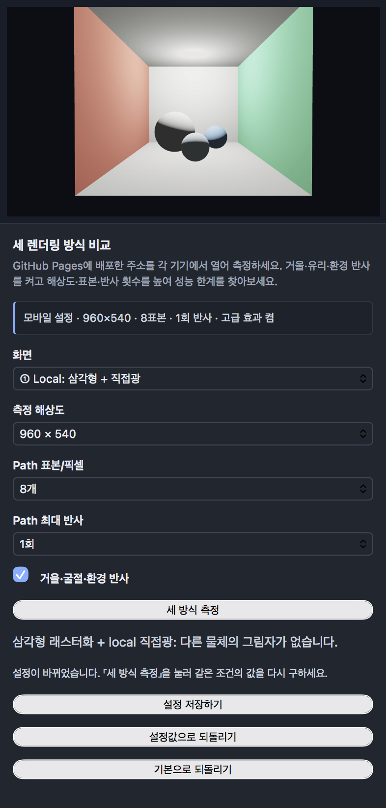
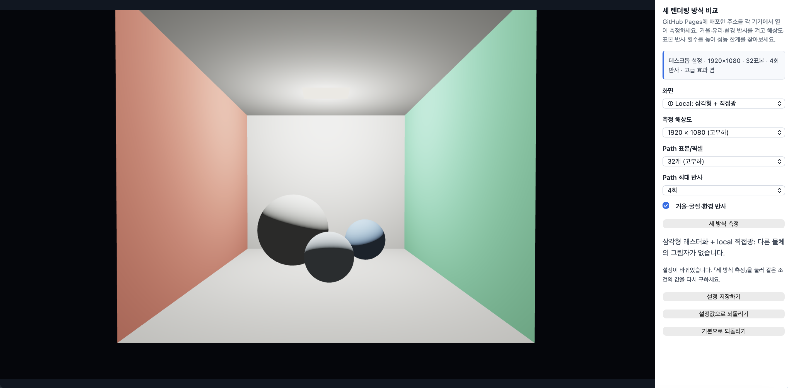

Week7

week7.md에는 실습 1의 일식·월식 캡처와 공전 위치·그림자 광선의 역할을 적습니다. 


## task 1


## task 2

### 1. 배포와 기기 : PC+휴대폰
사양
| 기기 종류 | GPU | CPU(확인 가능한 범위) | 운영체제 | 브라우저 | 전원 상태
| - | - | - | - | - | - |
| MacBook Pro 14 | Apple M2 Pro 19-Core GPU | Apple M2 Pro | macOS Tahoe (버전 26.6.2) | 사파리 | 59% (배터리 사용중)
| iPhone 15 Pro | GPU명 확인불가, GPU Benchmark Score: 24346 | Apple A17 @ 3.78 GHz | iOS 26.2.2 | 사파리 | 29% (배터리 사용중)

### 2.공통 조건 비교

*MacBook Pro 14 측정 결과*

| 방식 | 1회차 중앙값 | 1회차 Local 대비 | 2회차 중앙값 | 2회차 Local 대비 | 3회차 중앙값 | 3회차 Local 대비 | 
| - | - | - | - | - | - | - | 
| Local | 1.00 ms | 1.0배 | 1.00 ms | 1.0배 | 1.00 ms | 1.0배 | 
| Ray tracing | 1.00 ms | 1.0배 | 1.00 ms | 1.0배 | 1.00 ms | 1.0배 | 
| Path tracing | 8.00 ms | 8.0배 | 6.00 ms | 6.0배 | 5.00 ms | 5.0배 | 


*iPhone 15 Pro 측정 결과*
| 방식 | 1회차 중앙값 | 1회차 Local 대비 | 2회차 중앙값 | 2회차 Local 대비 | 3회차 중앙값 | 3회차 Local 대비 | 
| - | - | - | - | - | - | - | 
| Local | 1.00 ms | 1.0배 | 1.00 ms | 1.0배 | 2.00 ms | 2.0배 | 
| Ray tracing | 2.00 ms | 2.0배 | 2.00 ms | 2.0배 | 2.00 ms | 1.0배 | 
| Path tracing | 7.00 ms | 7.0배 | 8.00 ms | 8.0배 | 7.00 ms | 3.5배 | 

### 3. 부하 올리기 (중앙값 비교)


**컴퓨터**

*해상도 변동 · Path 8표본/픽셀 · 최대 2회 반사*
| 방식 | 960(고급효과 O) | 960(고급효과 X) | 1280(고급효과 O) | 1280(고급효과X) | 1920(고급효과O) | 1920(고급효과X) |
| - | - | - | - | - | - | - |
| Local | 1.00ms | 1.00ms | 1.00ms | 1.00ms | 1.00ms | 1.00ms |
| Ray tracing | 1.00ms | 2.00ms | 2.00ms | 2.00ms | 3.00ms | 3.00ms |
| Path tracing | 7.00ms | 1.00ms | 9.00ms | 9.00ms | 19.00ms | 19.00ms |


*640×360 · Path 변동 · 최대 2회 반사*
| 방식 | 16개(고급효과O) | 16개(고급효과X) | 32개(고급효과O) | 32개(고급효과X) | 
| - | - | - | - | - | 
| Local | 1.00ms | 1.00ms | 1.00ms | 1.00ms |
| Ray tracing | 1.00ms | 1.00ms | 1.00ms | 1.00ms |
| Path tracing | 6.00ms | 8.00ms | 10.00ms | 10.00ms |


*640×360 · Path 8표본/픽셀 · 반사 변동*
| 방식  | 3회(고급효과O) | 3회(고급효과X) | 4회(고급효과O) | 4회(고급효과X) |
| - | - | - | - | - | 
| Local | 1.00ms | 1.00ms | 1.00ms | 1.00ms |
| Ray tracing | 1.00ms | 1.00ms | 1.00ms | 1.00ms |
| Path tracing | 6.00ms | 6.00ms | 7.00ms | 7.00ms |


**휴대폰**

*해상도 변동 · Path 8표본/픽셀 · 최대 2회 반사 *
| 방식 | 960(고급효과 O) | 960(고급효과 X) | 1280(고급효과 O) | 1280(고급효과X) | 1920(고급효과O) | 1920(고급효과X) |
| - | - | - | - | - | - | - |
| Local | 2.00ms | 2.00ms | 2.00ms | 2.00ms | 2.00ms | 2.00ms |
| Ray tracing | 3.00ms | 3.00ms | 4.00ms | 4.00ms | 4.00ms | 3.00ms |
| Path tracing | 11.00ms | 11.00ms | 18.00ms | 17.00ms | 37.00ms | 37.00ms |


*640×360 · Path 변동 · 최대 2회 반사*
| 방식 | 16개(고급효과O) | 16개(고급효과X) | 32개(고급효과O) | 32개(고급효과X) | 
| - | - | - | - | - | 
| Local | 1.00ms | 1.00ms | 1.00ms | 1.00ms |
| Ray tracing | 2.00ms | 2.00ms | 2.00ms | 2.00ms |
| Path tracing | 10.00ms | 10.00ms | 19.00ms | 18.00ms |


*640×360 · Path 8표본/픽셀 · 반사 변동*
| 방식  | 3회(고급효과O) | 3회(고급효과X) | 4회(고급효과O) | 4회(고급효과X) |
| - | - | - | - | - | 
| Local | 1.00ms | 1.00ms | 1.00ms | 1.00ms |
| Ray tracing | 2.00ms | 2.00ms | 2.00ms | 2.00ms |
| Path tracing | 8.00ms | 8.00ms | 9.00ms | 9.00ms |


### 4. 기기별 적정 수준 결정
휴대폰은 자주 조작하는 화면으로 사용감이 가볍고 속도가 빨라야 한다고 생각합니다. 다만 화질이 너무 낮다면 정보 전달력에 문제가 있을 것입니다. 그렇기에 **브라우저 동기화 포함 · 960×540 · Path 8표본/픽셀 · 최대 1회 반사 · 고급 효과 켬** 을 설정했습니다. 측정값은 다음과 같습니다. 

| 방식 |  중앙값 | Local 대비 |
| - | - | - | 
| Local | 1.00 ms | 1.0배 | 
| Ray tracing | 2.00 ms | 2.0배 | 
| Path tracing | 8.00 ms | 8.0배 | 


컴퓨터는 정적인 이미지를 초고화질로 보는데 적합하다고 생각했습니다. 그렇기에 세팅값은 브라우저 동기화 포함 · 1920×1080 · Path 32표본/픽셀 · 최대 4회 반사 · 고급 효과 켬.입니다.  측정값은 다음과 같습니다. 

| 방식 |  중앙값 | Local 대비 |
| - | - | - | 
| Local | 2.00 ms | 1.0배 | 
| Ray tracing | 3.00 ms | 1.5배 | 
| Path tracing | 131.00 ms | 65.5배 | 


**총정리**

| 기기·브라우저·측정 방식 | 조건(해상도/표본/반사/고급 효과) | Local | Ray tracing | Path tracing | 화질·반응 관찰 |
| - | - | - | - | - | - | 
| 맥북·공통 | 640×360 / 8 / 2 / 켬 | 1.00 ms | 1.00 ms | 8.00 ms | 낮음/매우빠름
| 아이폰·공통 | 640×360 / 8 / 2 / 켬 | 1.00 ms | 1.00 ms | 6.00 ms | 낮음/매우빠름
| 맥북·고부화 | 1920x1080 / 32 / 4 / 켬 | 1.00 ms | 3.00 ms | 125.00 ms | 매우높음/아주잠깐 딜레이가 있었음 |
| 아이폰·고부화 | 1920x1080 / 32 / 4 / 켬 | 3.00ms | 6.00 ms | 249.00ms | 매우높음/2초정도 딜레이 |
| 맥북·적정 | 1920×1080 / 32 / 4 / 켬 | 2.00 ms | 3.00 ms | 131.00 ms | 선명함/1초정도 딜레이 |
| 아이폰·적정 | 960×540 / 8 / 1 / 켬 | 1.00 ms | 2.00 ms | 8.00 ms | 흐릿하지만 핸드폰화면에 어울리는 화질/ 매우 빠름 |


### 접속 및 자동 새로고침 화면




### 대면 질의응답
- **같은 조건에서 두 기기의 Local·Ray·Path 시간이 어떻게 달랐나요? GPU 타이머와 동기화 포함 시간을 구분했나요?**


- **해상도·표본·반사 횟수·고급 효과 중 무엇이 가장 크게 느려지게 했나요? 캡처와 측정값으로 설명할 수 있나요?**


- **각 기기의 적정 설정과 허용 시간 기준은 무엇인가요? 페이지를 새로 열거나 새로고침하면 그 설정이 자동 적용되나요?**


- **어떤 코드를 수정했나요?**

코파일럿에게 다음과 같이 수정을 요청했습니다. 

```
1.사용자가 브라우저를 연 환경이 모바일인인지 컴퓨터인지 판별하는 기능을 만든다
2.컴퓨터에서 열었을시 기본 지정 설정은 resolution:'1920',samples:'32',bounces:'4',advanced:true(1920×1080 · Path 32표본/픽셀 · 최대 4회 반사 · 고급 효과 켬)이다
3.스마트폰(모바일)환경에서의 기본 지정 설정은 resolution:'960',samples:'8',bounces:'1' (960×540 · Path 8표본/픽셀 · 최대 1회 반사 · 고급 효과 켬)이다
4.저 두 기기별 설정을 localStorage에 저장한다
5.최초 접속시, 사용자가 브라우저를 연 환경이 컴퓨터일시 localStorage에서 위에서 저장해둔 컴퓨터용 값을 불러오게하고 모바일일시에는 localStorage에서 모바일용 설정을 불러온다
6.각 기기에서 페이지를 새로고침하면 수동 변경 없이 그 기기에 맞춘 설정과 렌더 화면이 자동으로 나온다
```
브라우저 정보를 이용하는 **기기 판별 기능**과 이에 따른 **기기별 기본설정**이 추가됐습니다.  또한 데스크톱과 모바일 설정이 섞이지 않도록 **기기별 localStorage 저장 기능**이 생겼으며 새로고침시 기기별 기본 설정으로 복원되도록 **기본값을 추가**하였습니다. 


하지만 사용도중 제가 설정한 값들이 브라우저를 꺼도 남아있으면 좋겠다는 생각이 들었습니다. 그래서 다음과 같이 수정을 요청했습니다. 

```
1. “지원 브라우저에서는 WebGL GPU 타이머로 그리기 명령의 실행 시간을 잽니다. 미지원 기기에서는 동기화 포함 경과 시간을 표시합니다. 측정 종류가 다르면 수치를 직접 비교하지 마세요. 고부하 설정은 낮은 값부터 한 단계씩 올리세요.”라고 적힌 텍스트 박스를 삭제한다
2. 해당 텍스트 박스가 있던 자리에 ‘세 방식 측정’버튼과 같은 크기의 ‘설정 저장하기’ 버튼을 만든다
3. 그 아래에는 같은 크기의 ‘설정값으로 되돌리기’버튼을 만든다
4. ‘설정값으로 되돌리기’ 아래에는 ‘기본으로 되돌리기’버튼을 만든다
5. 해당 버튼은 사용자가 변경한 설정을 저장하고싶은 경우를 위한 기능을 한다. manualStorage 저장소를 추가한 다음 사용자가 설정을 조작하고 ‘설정 저장하기’버튼을 누르면 그 설정값이 manualStorage에 저장되게끔 만든다. 사용자가 새롭게 설정값을 변경하고 그 상태에서 설정값 저장 버튼을 누르면 maualStorage 값도 변경되어야 하며 FILO 방식으로 작동된다
6. ‘설정 저장하기’ 버튼을 누르고 브라우저를 껐다가 다시 켜면 디폴트 설정값이 아닌 ‘설정 저장하기’에 가장 마지막으로 저장된 설정값으로 불러와지고 “데스크톱 설정 · 1920×1080 · 32표본 · 4회 반사 · 고급 효과 켬”과 같은 텍스트 끝부분에 “설정값 불러기 완료”라는 텍스트가 추가로 붙어. 이는 모바일도 동일하다
7. manualStorage는 각 브라우저 내에서만 존재해서 다른 디바이스나 같은 디바이스 내 다른 창에서는 공유되지 않는다
8. ‘기본값으로 되돌리기’ 버튼을 누르면 최초로 판별된 디바이스 종류에 따른 브라우저 디폴트 설정값으로 돌아간다
9. ‘설정값으로 되돌리기’ 버튼을 누르면 가장 최근 ‘설정 저장하기’를 눌러 저장된 설정값으로 자동설정된다
10. 가장 ‘기본값으로 되돌리기’가 창을 닫기 전 마지막으로 누른 버튼이라면 브라우저가 종료or새로고침되고 다시 켜졌을때는 기본 설정으로 설정이 불러와져야 한다
```

 **수정값들을 저장하는 manualStorage 구현**이 되었고 수정값 저장하기를 누른 뒤 브라우저를 새로고침하면 기본설정값이 아닌 저장된 수정값으로 화면이 나옵니다. 하지만 기본값 불러오기를 마지막으로 누르고 새로고침하면 다시 기본값으로 브라우저 세팅이 완료됩니다. 


